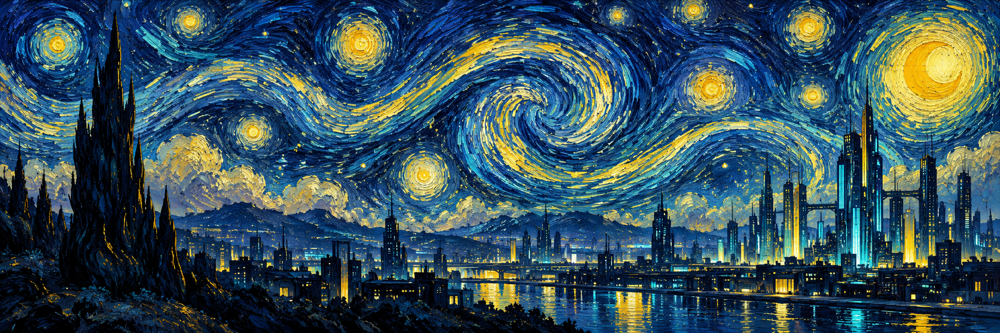

# Sichen Shao · 邵嗣琛

[**Academic homepage · 学术主页 ↗**](https://neotheonevd.github.io/)

**Computer vision & multimodal learning → world models & agents**  
**计算机视觉与多模态学习 · 世界模型与智能体**

I'm an undergraduate in **Information and Computing Science at Dalian University of Technology**. My research experience is in computer vision and multimodal learning, with a focus on cross-modal representations, information decomposition, and fusion.

我是大连理工大学信息与计算科学专业本科生。此前主要从事计算机视觉与多模态学习研究，关注跨模态表征、信息分解与融合。

## Current interests · 近期研究兴趣

| Generative models · 生成模型 | Agents · 智能体 |
| :--- | :--- |
| **World models** | **Recursive self-improvement (RSI)** |
| 世界模型 | 递归自我改进 |

## Selected research · 论文与研究

### JESD-ReID

**Aligning without Homogenizing: Jointly Explainable Common-Specific Decomposition for Multi-Modal Object Re-Identification**

*ICLR 2027 submission, under review · ICLR 2027 在审*  
*Co-first author, listed first · 共同第一作者，排名第一*

Separating shared and modality-specific evidence to align multimodal representations while preserving complementary information.

区分跨模态共性与模态特有信息，在对齐表征的同时保留互补线索。

## Education · 教育背景

**Dalian University of Technology · 大连理工大学**  
School of Mathematical Sciences · 数学科学学院  
Information and Computing Science, Undergraduate · 信息与计算科学，本科  
2024 – Present

---

Vision · Worlds · Agents / 视觉 · 世界 · 智能体
